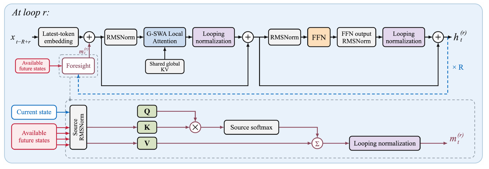

# ForesightLoop

**Parallel speed. Useful depth.** ForesightLoop aggregates completed cross-trajectory hidden states at loop boundaries, improving information flow while preserving token-parallel training and concurrent loop execution.



This repository contains the research model, a readable PyTorch training and inference reference, correctness tests, and checkpoint-loading examples. It starts from a clean source snapshot; cluster credentials, private launchers, training data, and optimizer states are not included.

## Models

| Model | Parameters | Loops | Training tokens | WikiText-2 PPL ↓ | LAMBADA PPL ↓ | Downstream avg. ↑ |
|---|---:|---:|---:|---:|---:|---:|
| [ForesightLoop-4](https://huggingface.co/thuEcstasy1/ForesightLoop-4) | 596,139,465 | 4 | 6B | 35.70 | 45.08 | 43.00 |
| [ForesightLoop-8](https://huggingface.co/thuEcstasy1/ForesightLoop-8) | 596,143,587 | 8 | 6B | 35.55 | 42.04 | 43.07 |

Both are **base text models**, pretrained from a common random initialization. They follow the Qwen3-0.6B backbone configuration and tokenizer; they are not instruction-tuned and are not fine-tunes of pretrained Qwen3 weights. Use natural text prefixes, without a chat template.

## Quick start

```bash
git clone https://github.com/thuEcstasy/ForesightLoop.git
cd ForesightLoop
pip install -e .
python scripts/generate.py --model thuEcstasy1/ForesightLoop-8 \
  --prompt "The scientist repeated the experiment and found that" --max-new-tokens 32
```

```python
from transformers import AutoTokenizer
from foresightloop import ForesightLoop

tokenizer = AutoTokenizer.from_pretrained("thuEcstasy1/ForesightLoop-8")
model = ForesightLoop.from_pretrained("thuEcstasy1/ForesightLoop-8", device="cuda")
prefix = "The scientist repeated the experiment and found that"
inputs = tokenizer(prefix, return_tensors="pt", add_special_tokens=False).input_ids.cuda()
output = model.generate(inputs, max_new_tokens=32, eos_token_id=tokenizer.eos_token_id)
print(tokenizer.decode(output[0, inputs.shape[1]:], skip_special_tokens=True))
```

`ForesightLoop` is a custom PyTorch class, not a Transformers `AutoModelForCausalLM` registration. The reference `generate` method uses greedy decoding with equally sized, unpadded prompts. The lower-level `prefill` and `decode` APIs additionally support explicit cache management, validity masks, document transitions, and cache reordering. Released weights retain FP32 precision.

## Architecture and training

The shared backbone has 28 layers, hidden dimension 1,024, FFN dimension 3,072, 16 query heads, eight KV heads, and head dimension 128. G-SWA shares first-loop global KV entries, with a private 64-token local window for each later loop. Attention residual aggregation reads the previous execution cycle's shallower-loop states. These are already computed, causal representations; later trajectory indices do not provide future input tokens.

Training processes loops in order and sequence positions in parallel. `Model.forward(tokens, targets)` returns **summed** next-token cross-entropy. The example training script divides by the number of target tokens and supports ordinary PyTorch DDP. It consumes pretokenized data; the original corpus packing order and cluster orchestration are not part of this release.

```bash
# File layout: little-endian uint32 token IDs, rows of sequence_length + 1.
torchrun --standalone --nproc_per_node=4 scripts/train.py \
  --tokens /path/to/train.u32 --loops 4 --sequence-length 1024 \
  --global-batch-size 128 --micro-batch-size 1 --steps 45777 --output checkpoints/r4
```

Main models were pretrained on FineWeb-Edu with a 6B-token budget; component ablations used 1B tokens. Increasing loop count increases training compute under this fixed-data comparison. See [training settings](configs/training.json).

## Correctness and performance scope

```bash
pip install -e '.[test]'
OMP_NUM_THREADS=1 pytest -q
```

Tests compare token-parallel execution, incremental decoding, and an independently written token-by-token aggregation oracle. They also check prefix causality, document boundaries, padding, gradients, and checkpoint round trips. Export validation checks every tensor against the training checkpoint; released-model checks compare full-size FP32 logits with the frozen evaluation graph.

**The eager reference is intended for correctness and understanding. It does not reproduce the paper's optimized decoding latency.** Paper timings use a separate CUDA Graph implementation with vLLM FA4 and custom Triton kernels. They are not vLLM serving-scheduler measurements. Recorded timings and exact workload definitions are preserved in [results](results/decode-latency-gb200-b32.csv) and [benchmark notes](docs/benchmarks.md).

At eight loops, ForesightLoop improves the seven-task average by 0.84 percentage points over PLT and adds about 0.3% decode-only latency in the reported GB200 batch-32 benchmark. LT retains higher absolute quality, at substantially longer decoding latency. Evidence currently covers approximately 0.6B dense models and measured loop counts of four and eight; larger models, MoE, and deeper recurrence remain open.

## License

Code and released model weights: Apache-2.0. See [LICENSE](LICENSE) and [NOTICE](NOTICE). Upstream tokenizer and dependencies retain their respective licenses. No training corpus is redistributed.
